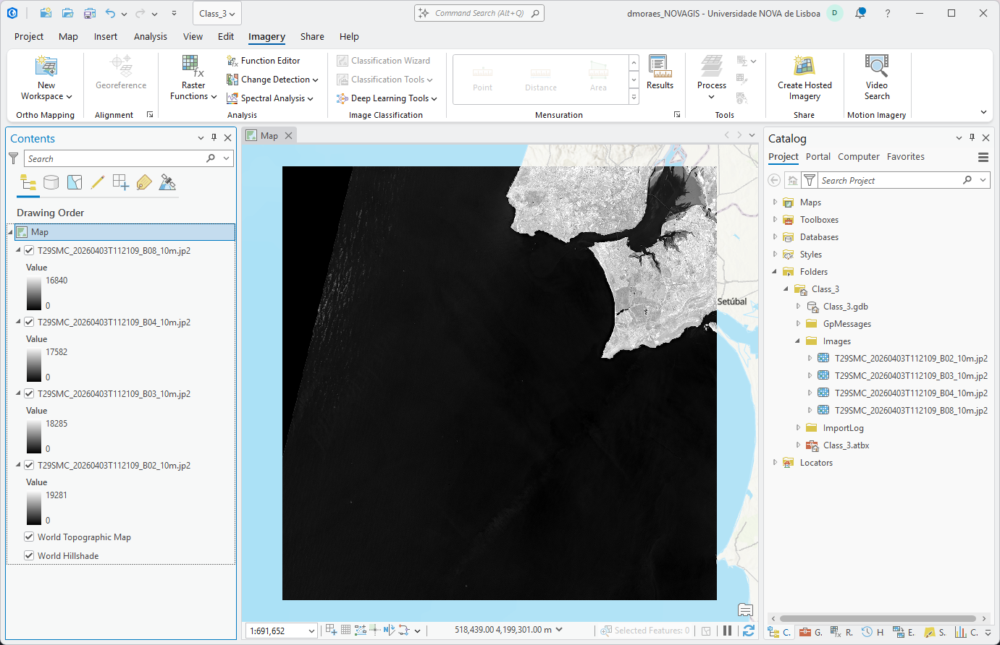
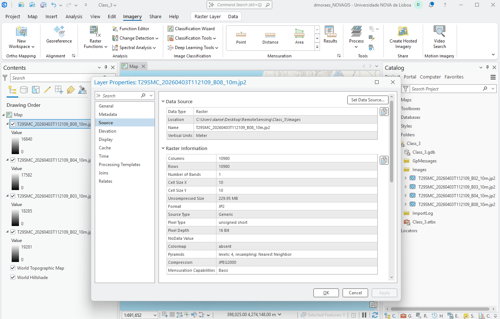
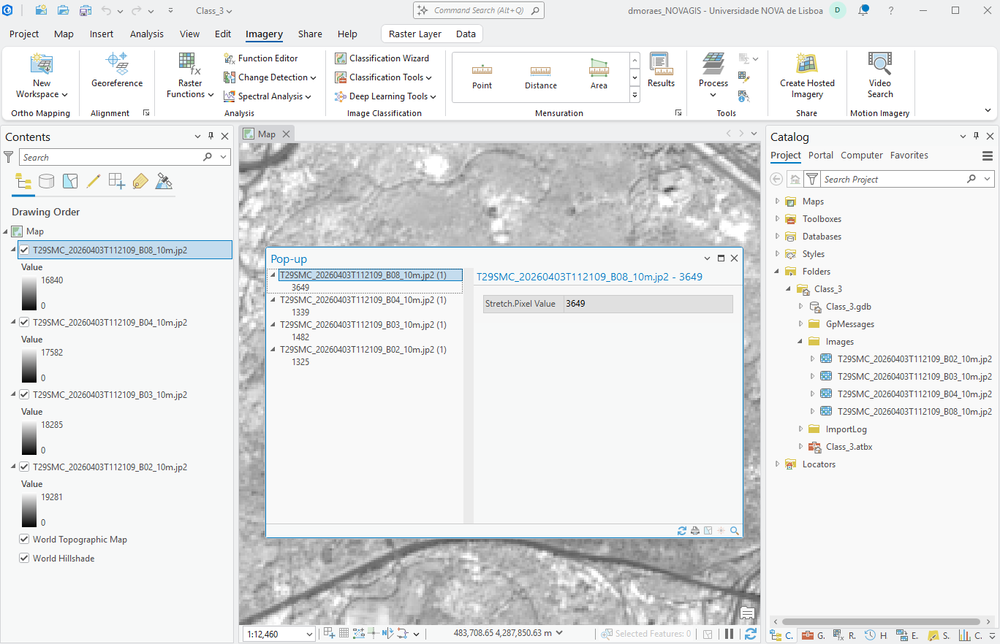
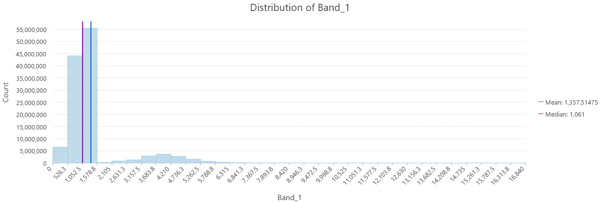
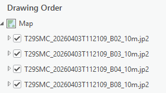
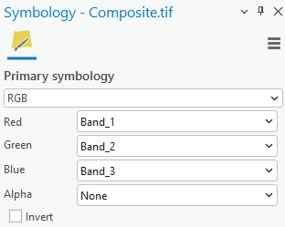
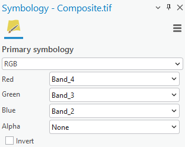
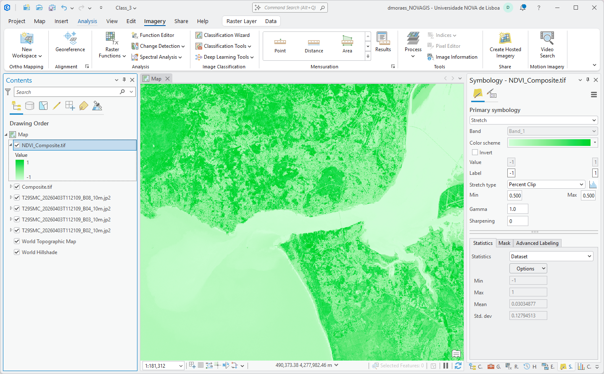
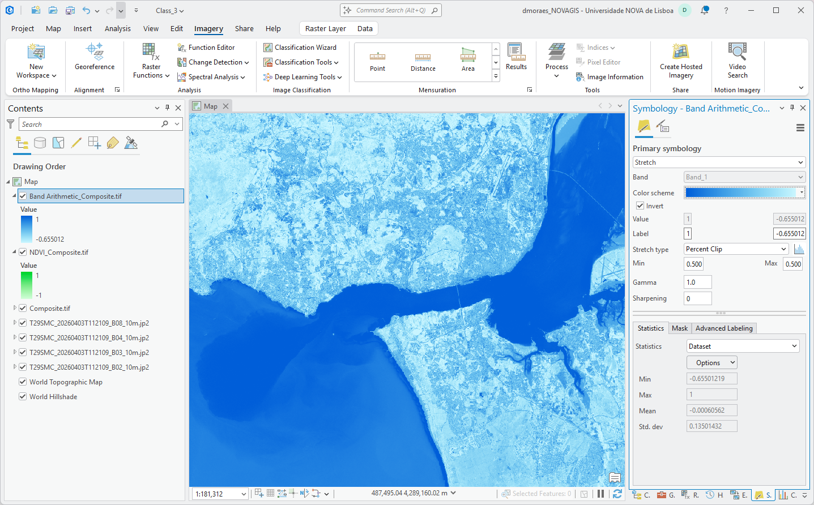

# Lab 1 (Class 3)

## Lab Overview

This practical session walks through the initial steps of image visualization, from opening images in a GIS software to creating color composites and mosaics.

---

## Requirements

- A GIS software of your choice (e.g. ArcGIS, QGIS)
- Download Class 3 materials
    - Link: Class_3

## Download Images

1. Download the “Class_3” materials from this link
    - Link: Class_3
2. Copy the “Images” folder to the RemoteSensing/Class_3 folder

## Configure ArcGIS Pro Project

1. Open ArcGIS Pro
2. In the “New Project” menu, choose “Map”
3. In the “New Project” window:
    - Name the project “Class_3”
    - Check the “Create a folder for this local project” box
    - Click on the folder icon on the right of the “Location” box
    - Create a new folder named “RemoteSensing” for the course: right click > folder
    - Remember the location of this folder for future classes
    - Select the “RemoteSensing” folder you have just created and click on “OK”
    - Click on “OK” to create the project folder

---

## Inspect the images folder

The **Images** folder contains 4 images, each corresponding to a Sentinel-2 10m band:

- `T29SMC_20260403T112109_B02_10m.jp2` → Band 2 (Blue)
- `T29SMC_20260403T112109_B03_10m.jp2` → Band 3 (Green)
- `T29SMC_20260403T112109_B04_10m.jp2` → Band 4 (Red)
- `T29SMC_20260403T112109_B08_10m.jp2` → Band 8 (Near Infrared)

## Open the images on ArcGIS

1. Images can be opened by dragging and dropping
2. Alternatively, add image from file
    - Catalog > Folders > Class_3 > Images
    - Add images to map: right click > Add to Current Map
3. Select “Yes” if ArcGIS Pro asks to calculate image statistics

    
    
## View image properties

1. Right click on some image in the “Contents” pane and select “Properties”
2. In the menu on the left, select “Source”
3. Check image properties such as:
    - Width
    - Height
    - Data type
    - Compression type
    - Coordinate Reference System
    - Spatial Information

    

    ??? question "Question: What is the spatial resolution of this image?"

        Answer: 10 meters, as seen in the Cell Size X and Y fields.

    
4. Pan around the map and explore the image. Where on Earth is this image? Is it spatially coherent? Add a basemap to assess if the image is correctly georeferenced.

5. Inspect pixel values by clicking on pixels on the map. Choose pixels at different locations and land cover types. Compare the values.
    
    
    
## Compute the image histogram
    
A histogram is a chart that shows the distribution of pixel values across an image. It helps assess image contrast, spot anomalies or outliers and identify groups of pixels with similar values.
(check histogram section of the book to include better description of this last bit)

1. Right click on the B08 image and select “Create Chart” > “Histogram”
2. In the “Variables” section, select “Band_1”. Wait for the histogram to be computed
3. Evaluate the distribution of the histogram

??? question "Question: Based on the distribution seen at the B08 histogram, can you identify groups of pixels with similar values? What is their likely land cover types?"

    Yes. The first cluster (from 1,052 to 1,578) corresponds to water pixels, while the second cluster (from from 2,105 to 5,788) corresponds to land.
    

## Create Composites

The images loaded on ArcGIS Pro correspond to Sentinel-2 Blue, Green, Red and Near Infrared bands, as shown in the table below. In this section, we are going to combine these bands into a single, multiband image. This multiband image is also called **composite**. 

| **Image**                        | **Band**           |
| :------------------------------- | :------------------ |
| `T29SMC_20260403T112109_B02_10m` | Blue                |
| `T29SMC_20260403T112109_B03_10m` | Green               |
| `T29SMC_20260403T112109_B04_10m` | Red                 |
| `T29SMC_20260403T112109_B08_10m` | Near Infrared (NIR) |

### Create a composite with the RGB and NIR bands
1. In order to preserve the natural order of the bands, first we should organize the images in the “Contents” pane in the correct order. Change the order of the layers, so that Band 02 is at the top and B08 is at the bottom, as shown:
        
    
        
2. Next, select the images (click + shift) in the “Contents” pane from top to bottom
3. In the “Imagery” tab, go to “Process” and select “Composite”
4. The composite will be created and added to the “Contents” pane

### Export composite to TIF file
    
!!! note "GeoTIFF format"

    The TIF (or GeoTIFF) format stores raster images along with geographic metadata, such as map projections, coordinates, and spatial resolution, allowing remote sensing data to be accurately located on Earth's surface.
    
    When exporting an image into a GeoTIFF file format, multiple settings can be defined, such as:
    
    - Coordinate Reference System (e.g. EPSG:3736) 
    - Data type (e.g. Int16) 
    - Pixel size (e.g. 10 m)        
    - NoData value (e.g. 65535)        
    - Compression method (e.g. LZW, deflate)        
    - Pyramids or overviews (lower-resolution copies of a raster image that enable fast panning and zooming)

1. Right click on the composite and select “Data” > “Export Raster”
2. In the “Output Raster Dataset”, change the file name to “Composite_uncompressed.tif”
3. In the “General” tab, leave all settings as default. Make sure the “Compression Type” is set to “None”
4. In the “Settings” tab, under the “Pyramids” section uncheck the “Build” box
5. Click “Export” to create the GeoTIFF file
        
    > Navigate to the project folder and inspect the files that were created. Note that the “Composite_uncompressed.tif” has approximately 946 MB. You can also pan and zoom in/out on the map to assess the composite's renderization speed.
    
6. Now let’s export the composite again, but this time with the following settings:
    - “Output Raster Dataset”: “Composite.tif”
    - “Compression Type”: LZW
    - “Pyramids”: check the “Build” box (leave the parameters at their default values)
7. Export the composite with these new settings
    
    > Navigate again to the project folder. Check the files that were created. The “Composite.tif.ovr” is the pyramids file, which contains downsampled copies of the composite that allow faster renderization when zooming in/out. Also, note that the “Composite.tif” has approximately 637 MB, a reduction of ~300 MB due to compression. Always compress rasters to save disk space.
    
8. Compare the visualization of both exported composites
9. Remove the “Composite_uncompressed.tif” layer from ArcGIS and delete the file from the project folder

!!!!!!!!!!!!1 ps: try to show the pyramids visualization app/video !!!!!!!!!!!!! 

### Modify the visualization
    
GIS software typically display multiband imagery using an RGB renderer. By default, the red, green, and blue channels are mapped sequentially to the first three bands of the raster (Red: Band 1, Green: Band 2, Blue: Band 3).

!!! question "Inspect the image. Do the colors look correct?"

Change the symbology to match the bands to the correct channels.

- Right click on the composite layer and select “Symbology”
- Change the symbology to:

    Red → Band_3 | Green → Band_2 | Blue → Band_1
    
    
    
    
    > Note that the band numbers do not correspond to the Sentinel-2 band numbers anymore, as this is a custom, new composite
        
Inspect the image on the map again and validate if the new symbology is correct.

In the “Symbology” tab, experiment with different contrast configurations.
    
**Add a text explaining how stretching and contrast work.** !!!!!!!!!!!!!!1

- In the “Stretch type” option, select “None”. With this option, no stretch is applied and the image looks darker
- Play with other stretch types. Change the “Min” and “Max” values in the “Percent clip” option. Choose the configuration that looks the best to you

### Create a False Color composite
    
A visualization that has the RGB channels assigned to the respective RGB bands is called a **True Color** composite. However, we can map the RGB channels to different bands in order to highlight some characteristics of the landscape that are invisible to the human eye. This type of visualization is called **False Color** composite.

To create a NIR false color composite to highlight vegetation, map the RGB channels to the NIR, Red and Green bands (in that order)
    

        

This false color composite highlights vegetation in different shades of red and is used to assess plant density and health. Healthy vegetation appear in vibrant shades of red, as they reflect near-infrared and green light and absorb red light. Denser vegetation, such as forests, tend to appear in darker red. Brown color can indicate stressed vegetation, while black may correspond to burned areas.
    

## Spectral Indices

Spectral indices are mathematical formulas combining two or more spectral bands to isolate, highlight, and quantify specific land cover properties such as vegetation health, water bodies, or soil moisture in remote sensing imagery. Commonly used spectral indices are shown in the table below.

| **Index** | **Formula** | **Use Case** |
| --- | --- | --- |
| Normalized Difference Vegetation Index |  $NDVI = \frac{(NIR- RED)}{(NIR + RED)}$ | Measuring green vegetation density and overall plant health |
| Normalized Difference Built-up Index | $NDBI = \frac{(SWIR - NIR)}{(SWIR + NIR)}$ | Identifying urban areas and impervious built surfaces |
| Normalized Difference Water Index | $NDWI = \frac{(GREEN - NIR)}{(GREEN + NIR)}$ | Delineating open water bodies and tracking changes in surface water extent |
| Normalized Burn Ratio | $NBR = \frac{(NIR - SWIR)}{(NIR + SWIR)}$ | Assessing burn severity and ecosystem recovery in post-fire landscapes |
| Enhanced Vegetation Index | $EVI = 2.5 * \frac{(NIR - RED)}{(NIR + 6*RED - 7.5*BLUE + 1)}$ | Quantifying vegetation canopy structure and health in high-biomass regions |

### Compute NDVI (ArcGIS Indices tool)

ArcGIS Pro offers a an easy tool to compute a range of pre-selected spectral indices. We are going to use this tool to compute the NDVI.

1. Select the "Composite.tif" in the Contents pane
2. In the "Imagery" tab, go to "Indices" and select "NDVI"
3. In the prompted window, set:
    - "Near Infrared Band Index" to "4 - Band_4" 
    - "Red Band Index" to "3 - Band_3"
4. Press "OK". ArcGIS Pro will plug the corresponding bands into the NDVI formula and compute the index
5. (Optional) Change the symbology to a scale of green. "Symbology" > "Color scheme" > "Green Bright"

??? question "What is the range of NDVI values?"

    NDVI values range from -1 to 1. To match the Sentinel-2 16-bit integer data type and band scaling, multiply the calculated NDVI by 10,000.

In an NDVI map, vegetation pixels tend to have higher values, while soil and built-up have lower values. Water often has negative NDVI values. Using a white-green color scale means that vegetation will appear in stronger green, while the other land cover types will appear light green.

### Compute NDWI (Band Arithmetic)

This is an agnostic tool that allows computing custom indices by defining their formula.

1. In the "Imagery" tab, select "Raster Functions"
2. Look for the "Math" group and select "Band Arithmetic"
3. In the "Raster" field, select the "Composite.tif"
4. In "Method", select "User Defined"
5. In band indexes, enter the formula of the NDWI index: `(B2 - B4)/(B2 + B4)`
6. (Optinal) Change the symbology to a scale of blue. 
    - "Symbology" > "Color scheme" > "Bathymetry #2" > Check the "Invert" box

The NDWI highlights open water features and vegetation water content (high NDWI values).
