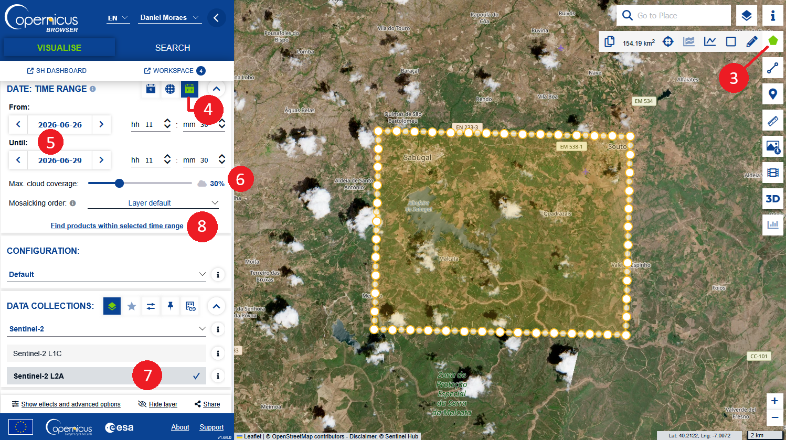
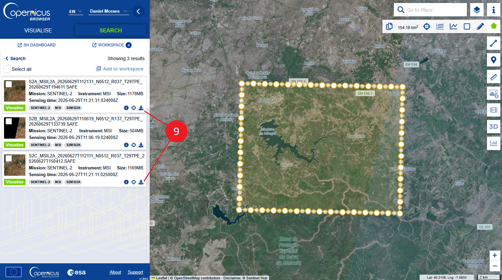
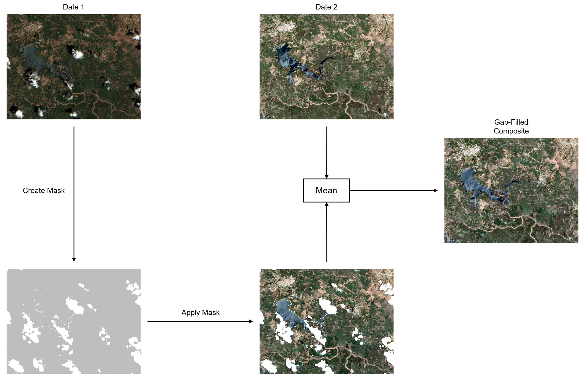
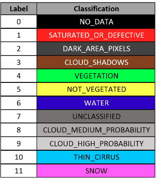
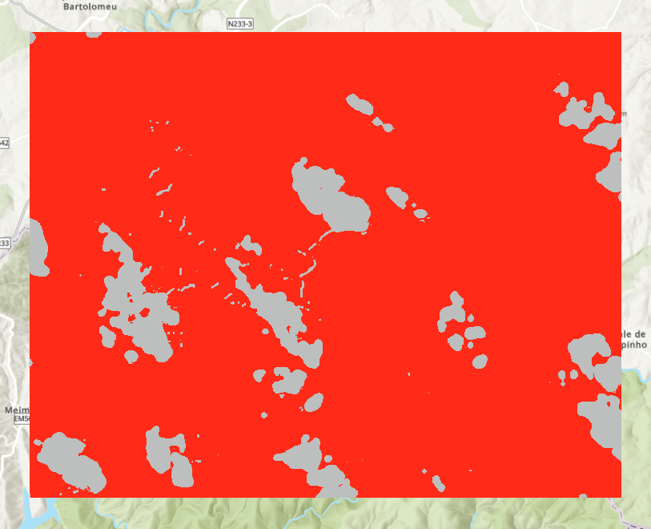
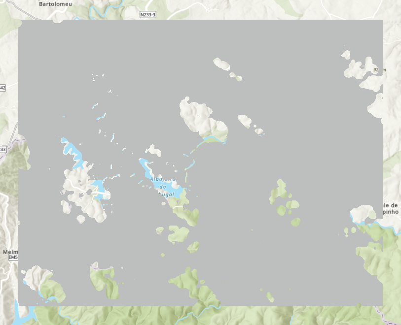
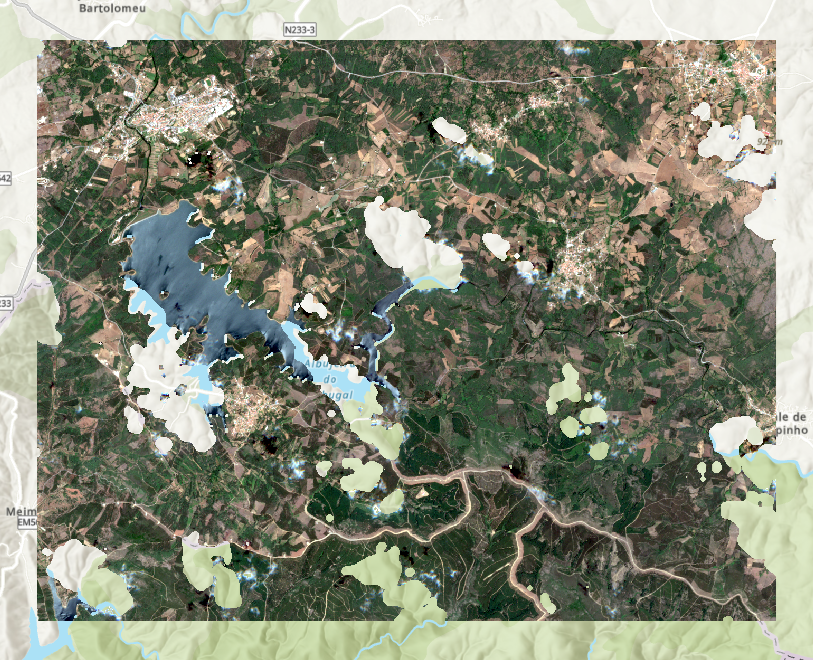
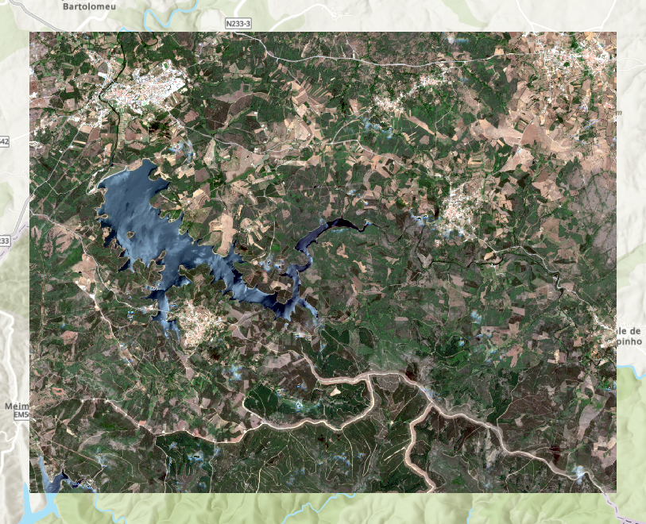

# Lab 2 (Class 5)

## Lab Overview

In this Lab, you will learn how to acquire and preprocess Sentinel-2 imagery, as well as prepare the composites that will be used in Lab 3.

This practical session is divided into 3 parts:

- **Part 1**: Download Sentinel-2 data from CDSE
- **Part 2**: Pre-processing Sentinel-2 images
- **Part 3**: Feature Engineering

---

## Create ArcGIS Pro Project

Using the folder structure set up in Lab 1, create a *New Project* named `Lab_2` inside the `RemoteSensing` folder.

## Download Materials

- Download the `study_area.kml` file available in the [Lab_2 materials](https://liveeduisegiunl-my.sharepoint.com/:f:/g/personal/dmoraes_novaims_unl_pt/IgAiLoSqW8GJTZRzvG1ohN1_AUPwgOw8yemcbq3TDRsodd0?e=n1TSBb) folder
- Copy `study_area.kml` to the `Lab_2` folder created above

> Note: In Part 1, you will download the Sentinel-2 images directly from CDSE. If you run into download issues, backup copies are available in the Lab_2 materials folder.

---

## Part 1 - Download Sentinel-2 data

In this first part of the Lab, we are going to download Sentinel-2 images from the Copernicus Data Space Ecosystem (CDSE). Before starting, make sure you have created a CDSE account ([instructions here](../data/CDSE_account.md)).

We are going to download Sentinel-2 L2A images from `27/06/2026` and `29/06/2026`. 

1. Open the [CDSE browser](https://browser.dataspace.copernicus.eu)
2. Log in with your credentials
3. Define an area of interest by uploading a kml file. Click on the ==Create an area of interest=={.blue} icon in the top-right corner and select ==Define Area of Interest (AOI)=={.blue}. Then, in the ==File=={.blue} tab, browse to the `Lab_2` folder in your PC and select the `study_area.kml` file
4. In the menu on the left, change the ==DATE=={.blue} from ==Single Date=={.blue} to ==Time Range=={.blue}
5. In the date range, set the starting date (==From=={.blue}) to `27/06/2026` at `00:00` and the end date (==Until=={.blue}) to `29/06/2026` at `23:59`.
6. The ==Max. cloud coverage=={.blue} parameter limits the percentage of clouds in an image. Leave this parameter at `30%`
7. In the ==DATA COLLECTIONS=={.blue} section, make sure to select `Sentinel-2 L2A`
8. Click on ==Find products within selected time range=={.blue} to retrieve the available images

    

9. Click on the ==Download product=={.blue} icon to download the two images that cover the entire tile (approx. 1.1GB each). Do not download the product has a partial cover of the tile

    

Wait for the download, then copy and extract the downloaded contents to your `Lab_2` folder.


### Sentinel-2 Products

Inspect the product folder. Sentinel-2 products follow a naming convention and are distributed in the SAFE (Standard Archive Format for Europe), which is a structured folder hierarchy that contains imagery, metadata and other auxiliary data.

The images are in the `IMG_DATA` folder, inside the `GRANULE` directory.

??? note "Sentinel-2 Product Naming Convention"

    `MMM_MSIXXX_YYYYMMDDHHMMSS_Nxxyy_ROOO_Txxxxx_YYYYMMDDHHMMSS.SAFE`

    (Example: `S2B_MSIL2A_20250514T112119_N0511_R037_T29SMC_20250514T142031.SAFE`)

    * **`MMM`** (`S2B`): Mission identifier (`S2A`, `S2B`, or `S2C`).
    * **`MSIXXX`** (`MSIL2A`): Instrument (Multispectral Instrument) and processing level—typically **`MSIL1C`** (Top-of-Atmosphere reflectance) or **`MSIL2A`** (Bottom-of-Atmosphere surface reflectance).
    * **`YYYYMMDDHHMMSS`** (`20250514T112119`): Sensing start date and time (UTC) when the satellite acquired the image.
    * **`Nxxyy`** (`N0511`): Processing baseline number (version of the processing software/algorithms used, e.g., `05.11`).
    * **`ROOO`** (`R037`): Relative orbit number (`R001` to `R143`).
    * **`Txxxxx`** (`T29SMC`): Tile identifier based on the Military Grid Reference System (MGRS), indicating the 110 x 110 km geographic tile.
    * **`YYYYMMDDHHMMSS`** (`20250514T142031`): Product generation/creation date and time.

??? note "Sentinel-2 Product Folder Structure (SAFE)"


    Inside the top-level `.SAFE` directory, the data is organized into a standardized hierarchy:

    * **`GRANULE/`**: The main folder you will work with. It contains a subfolder for the specific tile, which holds:
        * **`IMG_DATA/`**: The actual spectral band images in **JPEG2000 (`.jp2`)** format. For **Level-2A** products, this is further split into resolution subfolders (**`R10m`**, **`R20m`**, and **`R60m`**) along with a True Color Image (`TCI`) and Scene Classification Layer (`SCL`).
        * **`QI_DATA/`**: Quality indicators, including cloud masks, snow/ice probabilities, and technical quality reports.
        * **`MTD_TL.xml`**: Tile-level metadata (e.g., sun/viewing angles, cloud cover percentage).

    * **`DATASTRIP/`**: Metadata and auxiliary information for the entire continuous orbital strip from which the tile was cut.
    * **`AUX_DATA/`**: Auxiliary files used during processing (such as meteorological or elevation data).
    * **`MTD_MSIL1C.xml`** / **`MTD_MSIL2A.xml`**: The main product metadata file describing the overall acquisition, band parameters, and quantification values.
    * **`manifest.safe`**: An XML index file listing all files and components inside the `.SAFE` package.
    * **`HTML/`** & **`rep_info/`**: Quick-look previews and XML schema definitions used to validate the product structure.

## Part 2 - Pre-processing Sentinel-2 images

The image of the first date (27/06/2026) contains clouds, hiding spectral information of parts of the terrain. In this second part, we are going to mask the clouds in this image and use the image of the second date (29/06/2026) to fill the gaps.



/// caption
Overview of the cloud masking and gap filling process. 
///


### Create Cloud Mask

1. Load the Bands B2, B3, B4 and B8 (10m) from the first date (27/06/2026) in ArcGIS
2. Create a multiband composite (==Imagery=={.blue} > ==Process=={.blue} > ==Composite=={.blue})

    > Remember to order the bands correctly to preserve their natural order.

3. Rename the composite to `Composite_date1`

4. Adjust the symbology to create a **True Color** composite

    > Red: Band 3; Green: Band 2; Blue: Band 1


5. Add to the map the *Scene Classification Layer (SCL)* available in: `IMG_DATA/R20m/T29TPE_20260627T112111_SCL_20m.jp2`

    ??? info "About SCL"

        The Scene Classification Layer (SCL) is a 20-meter resolution classification raster included in Sentinel-2 Level-2A products that automatically categorizes every pixel into 12 surface and atmospheric classes—such as clouds, cloud shadows, vegetation, bare soil, water, and snow—primarily for cloud masking and quality filtering.

        

6. Add the limits of our study area to ArcGIS (`study_area.kml`)

7. Clip the composite to the study area
    - Search for the ==Clip Raster=={.blue} tool in ==Analysis=={.blue} > ==Tools=={.blue}
    - In the *Input Raster* field, select `Composite_date1`
    - In the *Output Extent* field, select the `study_area`
    - In the *Output Raster Dataset* field, name the output `Composite_date1_Clip`

8. Clip the SCL to the study area
    - Search for the ==Clip Raster=={.blue} tool in ==Analysis=={.blue} > ==Tools=={.blue}
    - In the *Input Raster* field, select the `T29TPE_20260627T112111_SCL_20m` layer
    - In the *Output Extent* field, select the `study_area`
    - In the *Output Raster Dataset* field, name the output `SCL_date1_Clip`


9. Create a cloud and cloud shadow mask using the SCL layer
    - Search for the ==Raster Calculator=={.blue} in ==Analysis=={.blue} > ==Tools=={.blue}
    - Use the following expression to create a binary mask (a raster with zeros and ones) masks (set the pixel value to zero) the invalid pixels (e.g. clouds, shadows, saturated/defective pixels)
        ```
        (( "SCL_date1_Clip">3)&( "SCL_date1_Clip" <=7))|( "SCL_date1_Clip"==11)
        ```
    - Name the *Output raster* as `mask_date1_temp`

    
    /// caption
    Binary Mask (red=1, grey=0) computed based on SCL. 
    ///

10. Set the zeros to NoData in the resulting binary mask raster
    - Search for the ==Raster Calculator=={.blue} in ==Analysis=={.blue} > ==Tools=={.blue}
    - Use the `SetNull` operator as shown:
        ```
        SetNull("mask_date1_temp"==0, 1)
        ```
    - Name the *Output raster* as `mask_date1_temp2`


    ??? info "(Optional) Fuse steps 9 and 10 into a single operation"
        
        Steps 9 and 10 could be merged into a single operation in the raster calculator, as in:

        ```
        SetNull( (( "SCL_date1_Clip">3)&( "SCL_date1_Clip" <=7))|( "SCL_date1_Clip"==11)==0,1)
        ```

    
    
    /// caption
    Binary Mask (grey=1, empty=NoData).
    ///
    
11. Resample the mask from 20 m to 10 m
    - Search for the ==Resample=={.blue} tool in ==Analysis=={.blue} > ==Tools=={.blue}
    - Select  `mask_date1_temp2` as the *Input Raster*
    - Name the *Output Raster Dataset* as `mask_date1_final`
    - Change the spatial resolution, defining *X* and *Y* as `10`
    - Leave the *Resampling Techinique* as `Nearest Neighbors`

12. Mask the composite with the final cloud mask
    - Search for the ==Extract by Mask=={.blue} tool in ==Analysis=={.blue} > ==Tools=={.blue}
    - In the *Input raster* field, select the `Composite_date1_Clip`
    - In the *Input raster or feature mask data*, select `mask_date1_final`
    - Name the *Output raster* as `Composite_date1_masked`
    - For *Extraction Area*, select `Inside`

    
    /// caption
    Masked Composite (True Color composition).
    ///

??? note "About NoData and missing values"

    `NoData` is a special raster value representing the absence of a valid measurement, ensuring that pixels removed during cloud masking are ignored in subsequent statistical calculations and compositing rather than treated as zeros. Visually, GIS software typically renders `NoData` pixels as transparent.

### Fill Gaps

Masking the pixels related to clouds and cloud shadows leaves empty spaces in the composite. We are going to use the image from the second date (29/06/2026) to fill those missing values.

1. Load the Bands B2, B3, B4 and B8 (10m) from the second date (29/06/2026) in ArcGIS
2. Create a composite (*remember to use bands in the correct order*)
3. Rename the composite to `Composite_date2`
4. Clip the composite to the study area, naming the output as `Composite_date2_Clip`
5. Create a Mosaic
    - In ==Imagery=={.blue} tab, select ==Raster Functions=={.blue}
    - Search for the ==Mosaic Rasters=={.blue} tool
    - Select the `Composite_date1_masked` and `Composite_date2_Clip`
    - In the *Operation* field, choose `Mean`

        > By choosing `Mean`, pixel values in the mosaic will be the average of pixels in the input composites.



/// caption
Composite after gap filling.
///


## Part 3 - Feature Engineering

The goal of this section is to generate the composites that will serve as inputs for the the next Lab (Lab 3: Pixel-Level Land Cover Classification).

Two composites must be exported as GeoTiffs:

- A Baseline composite (RGB + NIR)
- An NDVI composite (RGB + NIR + NDVI)

### Baseline Composite

For the Baseline composite, simply export the Mosaic created in the previous section:

- ==Right click=={.blue} > ==Data=={.blue} > ==Export Raster=={.blue}
- Name it `Composite_Baseline.tif`
- Leave the other fields as default

### NDVI

Compute the NDVI and add it to the Baseline Composite.

1. Compute NDVI
    - Select the Baseline Composite in the Contents pane
    - ==Imagery=={.blue} > ==Indices=={.blue} > ==NDVI=={.blue}
    - For *Near Infrared Band Index*, select `4 - Band 4`
    - For *Red Band Index*, select `3 - Band 3`

2. The resulting NDVI layer is in the [-1, 1] scale. In order to match the Baseline Composite scale, it needs to be multiplied by `10,000`

    > Tip: Use the **Band Arithmetic** tool


3. Create the NDVI composite (Bands: Blue, Green, Red, NIR, NDVI)
    - Select the scaled NDVI and the Baseline Composite layers in the Contents pane. To ensure the correct band order in the target composite, place the Baseline Composite on top


4. Export the NDVI composite as a GeoTiff file. Name it `Composite_NDVI.tif`
    - Set the *Pixel Type* to `16 Bit Signed`


## Exercise

Download a cloud-free image from the winter (e.g. `22/02/2026`) and create a temporal composite by stacking it to the Baseline Composite.

The temporal composite should have the following bands:

- Band 1: Blue (Baseline Composite)
- Band 2: Green (Baseline Composite)
- Band 3: Red (Baseline Composite)
- Band 4: NIR (Baseline Composite)
- Band 5: Blue (Winter image)
- Band 6: Green (Winter image)
- Band 7: Red (Winter image)
- Band 8: (Winter image)

Export the composite as `Composite_temporal.tif`.

<br><br>

:trophy: ==Congratulations, you reached the end of Lab 2.=={.green}