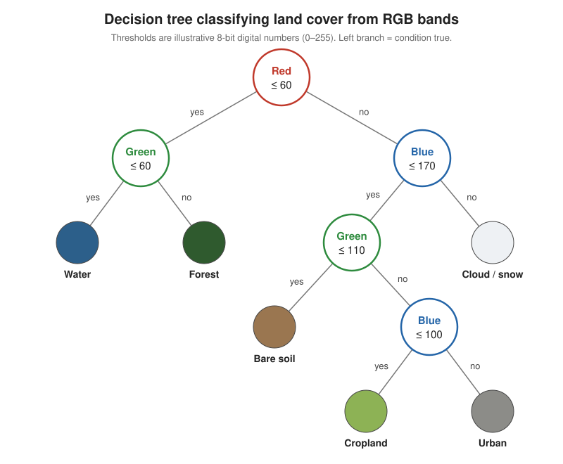
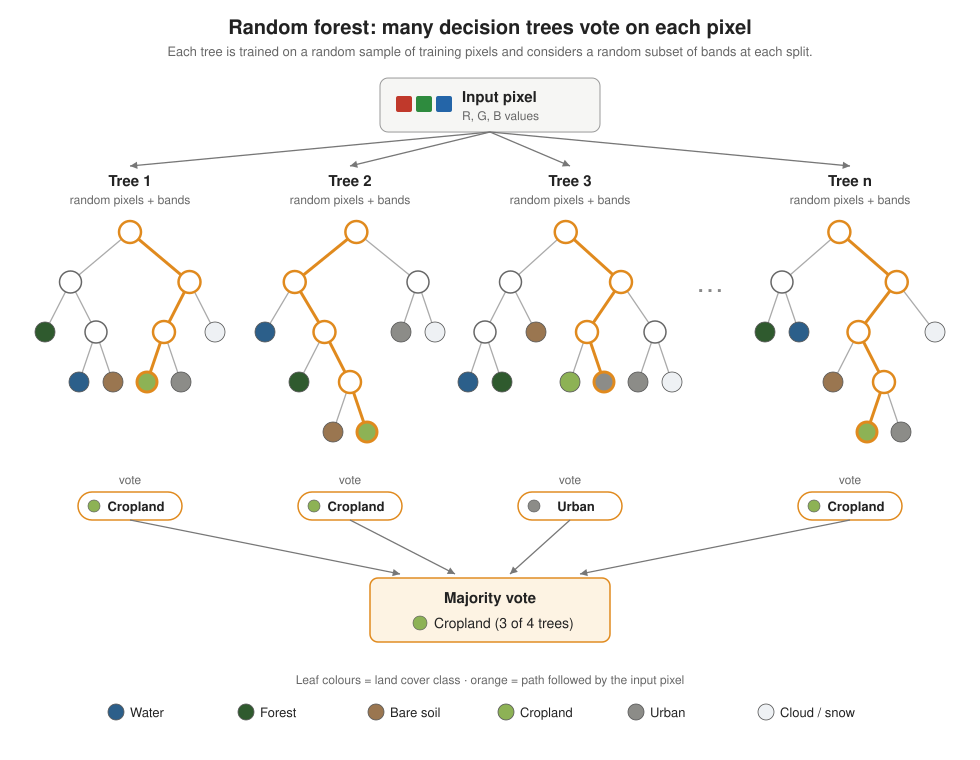
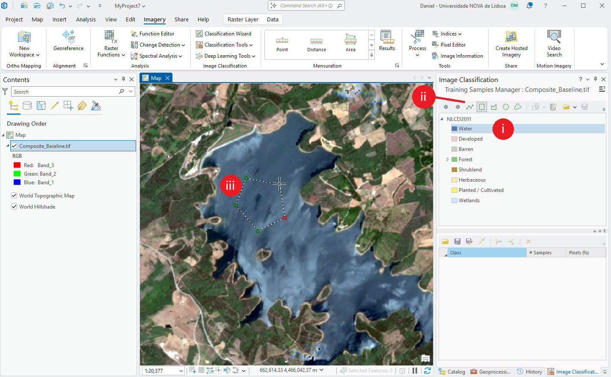
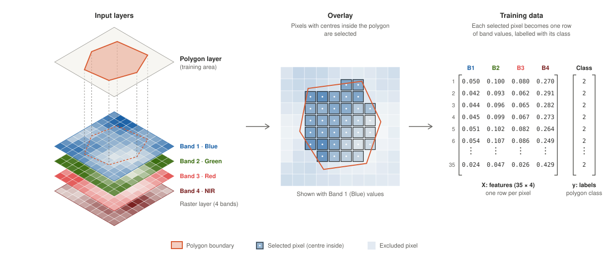
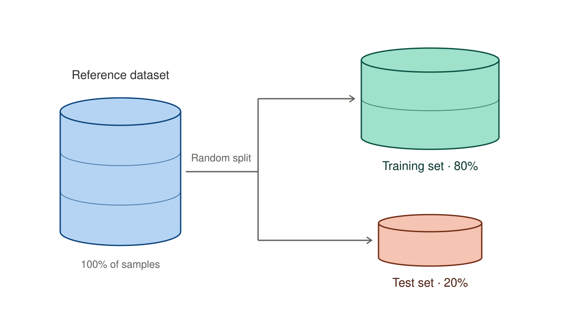
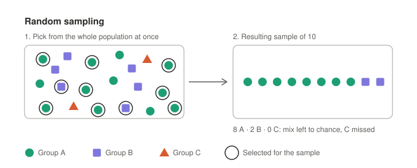
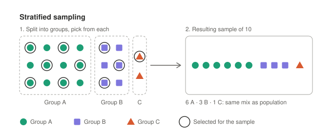

# Lab 3 (Class 6)

## Lab Overview

In this Lab, you will learn the basics of sample collection and how to perform land cover classification using the Random Forest algorithm.

---

## Create ArcGIS Pro Project

Using the folder structure set up in Lab 1, create a *New Project* named `Lab_3` inside the `RemoteSensing` folder.

## Download Materials

- Download the [Lab_3 materials](https://liveeduisegiunl-my.sharepoint.com/:f:/g/personal/dmoraes_novaims_unl_pt/IgCaz0X2yFqUTIL6vtNmgCXiAb9G83qO1AHv_MGw38BlrBU?e=eMeVN7)
- Copy the materials to the `Lab_3` folder

---

## Basics of Sampling Design

In supervised machine learning, algorithms learn from a set of labelled examples. In the context of remote sensing, sampling refers to selecting the locaions (e.g. pixels, areas) where the true class is known. These reference samples can be used for training the algorithm and assessing the accuracy of the resulting map.

Sampling design determines how locations are selected and has the following components:

- **Collection method**: manual collection (e.g. field surveys, visual interpretation of imagery), automatic collection (e.g. using existing maps)

- **Sampling method**: Simple Random, Stratified, Systematic

- **Sample size**: the sample needs to be large enough to capture the spectral variability of each class

- **Class balance**: classes should have a similar sample size, otherwise the algorithm tend to favor the over-represented classes

- **Spatial autocorrelation**: neighboring pixels tend do be relatively similar. If training and validation/test samples are acquired from the same polygon or adjacent locations, they are not truly independent and as a result the accuracy will be inflated. It is good practice to split the reference data by polygon or by cells in a spatial grid to prevent spatial autocorrelation.

## Random Forest

A random forest is an ensemble algorithm that combines many **decision trees**. Each tree is trained on a random sample of the training data, and at each split it can only choose from a random subset of the features. This randomness introduces diversity among the trees, so that their individual errors are largely uncorrelated. For classification, every tree votes for a class and the majority class wins, which gives more accurate and stable results than a single decision tree.

Random Forest is robust to noise in the training data, less prone to overfitting and has a strong performance on tabular data. Random forests are highly parallelizable, since each tree is trained and makes its prediction independently of the others, allowing the trees to be built and run at the same time on separate processors.

## (Optional) Manual Collection of Training Samples

Training samples can be collected manually either by drawing points or polygons on a GIS software based on visual interpretation of remote sensing imagery.

ArcGIS Pro offers a convenient tool that allows training sample collection in a user friendly way.

Follow the steps below to create a training sample:

1. Add the `Composite_Baseline.tif` to ArcGIS and select it in the *Contents* pane

2. In the ==Imagery=={.blue} tab, click on ==Classification Tools=={.blue} and select ==Training Samples Manager=={.blue}

3. You can use the default class schema (NLCD2011) and add/remove classes to fit your classification legend. Alternatively, create a new class scheme from scratch

4. To add a training sample, just choose a class (i) and a selection method (ii), such as point, rectangle, freehand *etc*. Next, select your point or draw the polygon on the map that captures samples of your class of interest (iii)

5. Add multiple training samples for every class in your class scheme

6. After completion, save the training samples as a feature class or shapefile

!!! info "In this Lab we are going to use a pre-existing training sample."

/// caption
Training sample collection on ArcGIS. 
///

## Reference Data for Land Cover Classification

This Lab utilizes a previously collected reference dataset. The class schema, also known as class nomenclature or map legend, comprises 6 classes as seen in the table below.

| Class | Value |
|---|---|
| Built-up | 1 |
| Crops and Pastures | 2 |
| Deciduous Trees | 3 |
| Evergreen Trees | 4 |
| Shrubs | 5 |
| Water | 6 |

We are going to use the `reference_sample.shp` that contains manually annotated polygons to extract our training features from the satellite imagery, as illustrated in the figure below.

{ .invert-dark }

## Data Splitting (Train/Test)

In this first phase, the dataset is partitioned into training and test subsets.

{ .invert-dark }

### Random Sampling

Random sampling selects members of a population with equal probability, independently of any grouping or characteristic. Consequently, subgroup representation in the sample is determined by chance, and small subgroups may be under-represented or omitted.

{ .invert-dark }

ArcGIS offers an out-of-the-box tool that allows to split a feature dataset into training and test sets.

1. Load the `reference_sample.shp` into ArcGIS

2. Search for the ==Subset Features=={.blue} tool in the ==Geoprocessing=={.blue} toolbox

3. Select the `reference_sample` as the *Input Features*

4. Name the *Output Training Feature Class* as `train_set` and *Output Test Feature Class* as `test_set`

5. Define the *Size of Training Feture Subset* as 80 and in the *Subset Size Units* select `PERCENTAGE_OF_INPUT`

    > The data will be split into 80% for training and 20% for test.

!!! question "Analyze the resulting train and test samples. Are they a good representation of the population?"

### Stratified Sampling

Stratified sampling divides a population into distinct subgroups, or strata, and selects members independently within each stratum, typically in proportion to its size. Consequently, every subgroup is guaranteed representation, and the sample reflects the composition of the population.

{ .invert-dark }

Unfortunately, ArcGIS does not offer a straightforward tool to perform stratified sampling. A possible workaround is presented in the steps below:

1. Split the reference sample by class
    - Search for the ==Split by Attributes=={.blue} tool in the ==Geoprocessing=={.blue} toolbox
    - Set the *Input Table or Features* to the `reference_sample`
    - In the *Target Workspace* create a folder called `split_class` in the `Lab_3` folder. Select the `split_class` folder
    - For *Split Fields* select `classname`
    - This will create 6 feature classes, one for each class in the reference sample, in the `split_class` folder

2. Subset each class into train and test sets
    - Search for the ==Subset Features=={.blue} tool in the ==Geoprocessing=={.blue} toolbox. Right-click on it and select *Batch*. Accept the default parameters and click *Next*
    - Add all the individual class shapefiles as inputs
    - Set the *Size of Training Feture Subset* to 80 and in the *Subset Size Units* select `PERCENTAGE_OF_INPUT`
    - Run the tool

3. Merge training subsets
    - Search for the ==Merge=={.blue} tool in the ==Geoprocessing=={.blue} toolbox
    - Add the training subsets of each class as the *Input Datasets*
    - Name the *Output Dataset* as `train_set_stratified`

4. Merge test subsets
    - Search for the ==Merge=={.blue} tool in the ==Geoprocessing=={.blue} toolbox
    - Add the test subsets of each class as the *Input Datasets*
    - Name the *Output Dataset* as `test_set_stratified`

## Classification

This section is dedicated to performing a land cover classification based on the Random Forest classifier (referred to as *Random Trees* in ArcGIS).

Two main approaches are described in this section:

- **Express Classification**: A fast and straightforward method for generating a preliminary land-cover map quickly without the extra steps of model tuning or statistical validation
- **End-to-end Workflow**: A comprehensive pipeline that trains the Random Forest classifier and validates the final map using the test dataset and a confusion matrix.

### Express Classification and Accuracy Assessment

Follow the steps below to conduct an express classification on ArcGIS:

1. In the *Contents* pane, select the input image (e.g. `Composite_Baseline`)

2. Go to ==Imagery=={.blue} > ==Classification Tools=={.blue} > ==Classify=={.blue}

3. Configure the classification parameters:
    - *Classifier*: `Random Trees` (ArcGIS version of Random Forest)
    - *Training Samples*: `train_set_stratified`
    - *Maximum Number of Samples per Class*: `0` (set to zero to use all available samples)
    - *Output Classified Dataset*: name the output as `clf_base_express`

4. Run the image classification. The classification map will be displayed when the classification is completed

5. For the accuracy assessment, search for the ==Compute Accuracy For Pixel Classification=={.blue} tool
    - *Input Raster*: `clf_base_express`
    - *Ground Truth Data*: `test_set_stratified`
    - *Number of Random Points*: `1,000`
    - Run the tool

6. Inspect the confusion matrix under *Standalone Tables*

### End-to-end Workflow

The end-to-end workflow is a comprehensive approach that allows training the model, conducting the accuracy assessment on the test set and then using the trained model to create the classification map.

This is the recommended approach in real-world applications, since it allows evaluating the accuracy of their trained model before creating the map, which is an expensive operation from a computational standpoint.

**Preparing the training and test data**

1. Open `Lab_3_Toolbox`

2. Run the ==Extract_Points_Lab3=={.blue} tool
    - Select the `Composite_Baseline.tif` as the *Input raster*
    - Select the `train_set_stratified` as the *Polygon Layer*
    - Name the *Output point features* as `train_set_points`

3. Repeat the same process, but this time for the test set
- Select the `Composite_Baseline.tif` as the *Input raster*
    - Select the `test_set_stratified` as the *Polygon Layer*
    - Name the *Output point features* as `test_set_points`

**Train Random Forest Model**

1. Open the ==Forest-based and Boosted Classification and Regression=={.blue} tool

2. Configure the tool as follows:
    - *Prediction Type*: `Predict to features`
    - *Model Type*: `Forest-based`
    - *Input Training Features*: `train_set_points`
    - *Variable to Predict*: `classvalue` (check the *Treat Variable as Categorical* box)
    - *Explanatory Training Rasters*: Click on the folder icon and navigate to the `Composite_Baseline.tif`. Double click on the tif file to see the 4 bands. Select all bands and press *OK*
    - *Input Prediction Features*: `test_set_points`
    - *Output Predicted Features*: `out_test`
    - *Output Trained Model File*: `model_rf_baseline`
    - *Output Trained Features*: `out_train`
    - Run the tool to start model training

3. Inspect the `out_train` and `out_test` datasets on the map

!!! info "You can change some hyperparameters (e.g. Number of Trees) to try to improve the model's performance"

**Evaluate Model Accuracy**

1. Open the `Prepare_Predicted_Points_Lab3` tool in the `Lab_3_Toolbox`
    - In *Test Polygons*, select `test_set_stratified`
    - In *Predictions (Points)*, select `out_test`

2. Now the `out_test` points have two columns that allow ArcGIS to compute a confusion matrix (*Classified* and *GrndTruth*)

3. Open the ==Compute Confusion Matrix=={.blue} tool
    - *Input Accuracy Assessment Points*: `out_test`
    - *Output Confusion Matrix*: `CM_Baseline`
    - Run the tool to compute the confusion matrix

4. The confusion matrix will be added to the contents pane (under *Standalone Tables* at the bottom). Inspect the confusion matrix (open attribute table)

**Create Classification Map**

If the model accuracy evaluated on the test set is satisfactory, we can proceed to using the model to create a classification map for our whole study area.

1. Open the ==Predict Using Spatial Statistic Model file=={.blue} tool

2. Use the settings below:
    - *Input Model File*: `model_rf_baseline.ssm`
    - *Prediction Type*: `Predict to raster`
    - *Output Predicted Raster*: `map_clf_baseline`
    - Click on the folder icon and navigate to the `Composite_Baseline.tif`. Double click on the tif file to see the 4 bands. Select all bands and press *OK*. Make sure the *Prediction* bands match the *Training* bands
    - Run the prediction to create the map

3. Inspect the classification map

## Exercise

Load the `Composite_NDVI` created during the last Lab. In addition to the 4 bands of the baseline composite, it has the NDVI as the fifth band.

Train a Random Trees model using the `Composite_NDVI` as the input. Evaluate the accuracy on the test set. Compare the accuracy of this model to the baseline model to assess if including the NDVI improved the predictive capabilities of the model.

Similarly, repeat the process using the bi-temporal composite created in the last Lab.

  

:military_medal: ==Congratulations, you reached the end of Lab 3.=={.green}
